# AI Career Navigator

> A workforce-foresight copilot that turns dated AI-trend signals into a defensible reskilling
> plan — matched to your real skills, stress-tested across three 2028 scenarios, and mapped to
> all 17 UN Sustainable Development Goals.

**SDC 2026 · Domain 1 — Aiversecity Future-Ready Workforce · Team 418 I'm a Teapot**

---

## Team information

| Field | Details |
| ----- | ------- |
| **Team** | 418 I'm a Teapot |
| **Domain** | Domain 1 — Future-Ready Workforce |
| **SDG track** | SDG 8 — Decent Work and Economic Growth (cross-cutting SDG 4, 10 and 17 through the role-level mapping) |
| **Leader** | CHEN XIANGYU |
| **University** | Xiamen University Malaysia |
| **Team size** | 5 |

## Links

| Resource | Link |
| -------- | ---- |
| GitHub Repository | <https://github.com/your-username/your-project> *(to be updated)* |
| Replit Project | <https://replit.com/@your-username/your-project> *(to be updated)* |
| Live Demo | <https://your-project.replit.app> *(to be updated)* |
| RunPod Endpoint | <https://api.runpod.ai/v2/your-endpoint-id> *(to be updated)* |
| Slide Deck | *(to be updated)* |
| Demo Video | *(to be updated)* |

---

## Overview

### The problem

AI is changing which skills matter faster than any training catalogue can follow. Workers are
told to "reskill" without knowing which skills will still be valuable, employers cannot explain
which roles are emerging, and public programmes cannot show how a reskilling budget connects to
the SDGs. Most career tools produce a score and a list of courses; almost none show their
evidence, their assumptions, or what happens if the future turns out differently.

### The solution

**AI Career Navigator** is a separated frontend/backend web application:

* **Skills profile intake** captures what a person can actually do (23 skills, self-rated 1–5),
  plus time, budget and interests.
* **A dated signal layer** collects labour-market, policy and technology signals — every record
  has a publisher, a publication date and a source link, so the forecast can be audited.
* **Scenario-aware matching** scores 12 future roles under three explicit 2028 futures, showing
  fit, the exact skills gap, salary band, automation risk and the reasons behind every score.
* **A personalised reskilling pathway** sequences open and low-cost modules into three phases,
  with hours, cost, milestones and evidence artefacts.
* **SDG mapping** connects each matched role to the 17 goals with a weighted rationale and
  supporting signals.
* **An LLM narrative** turns the structured result into a written briefing a mentor or manager
  can act on — generated server-side, never exposing keys to the browser.

The frontend is a build-free SPA; the backend owns the database, scoring and third-party model
calls. The UI can run on a complete demo dataset when the API is unavailable, and it says so.

## Requirement coverage

| Must-have from the Domain 1 brief | Where it is implemented |
| --------------------------------- | ----------------------- |
| Skills profile intake | `#/intake` — four-step wizard, validated, persisted via `POST /profiles` |
| AI-trend signal layer (updatable, dated source) | `#/signals` — filters, evidence modal, source links, `POST /signals/refresh` |
| Future-role matching + skills gap | `#/matches` and `#/overview` — fit scores, gap matrix, role detail |
| Personalised reskilling pathway | `#/pathway` — phases, modules, cost, milestones, coverage, print/copy |
| SDG mapping | `#/sdg` — all 17 goals, contribution scores, role and skill links, evidence |
| More than one future scenario | `#/scenarios` + scenario selector in the top bar — three futures re-score everything |

## Screens

**Landing — the product in one screen**

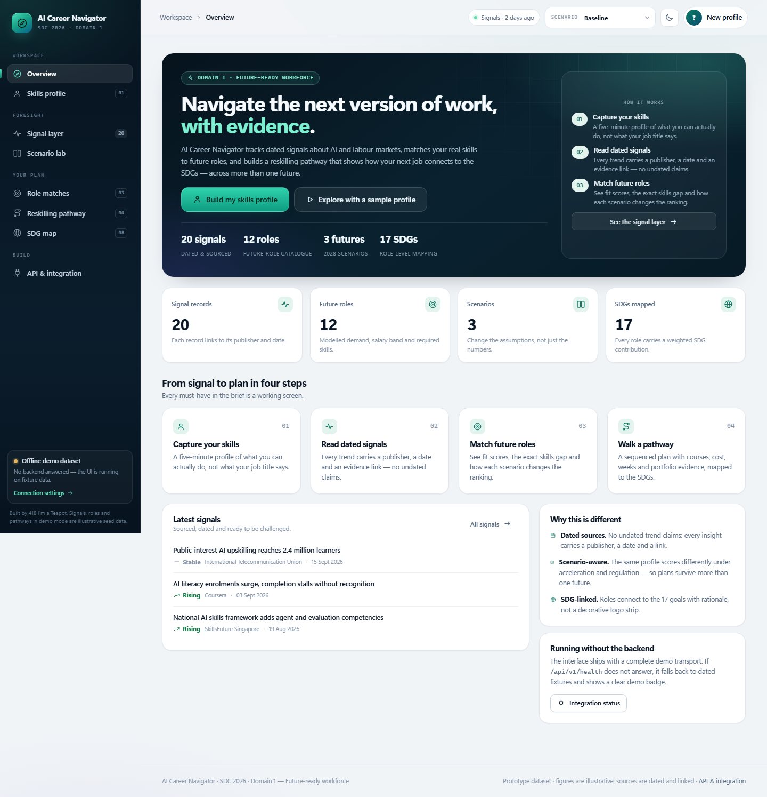

**Personal dashboard — readiness, top roles, capability radar, scenario sensitivity, SDG footprint**

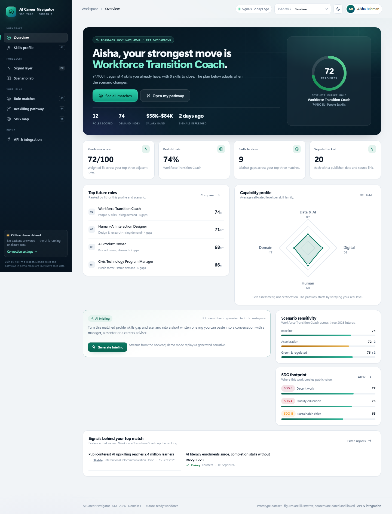

**Signal layer — every trend dated and linked to its publisher**

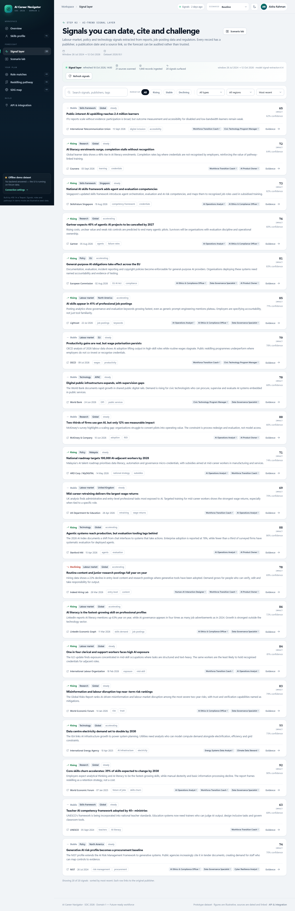

**Role matching — fit, gaps and reasons, with a cross-role gap matrix**

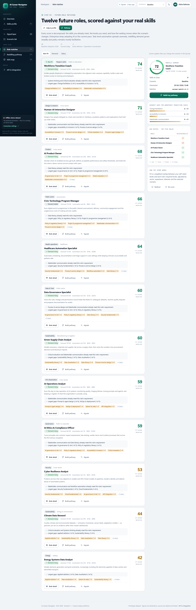

**Reskilling pathway — phases, modules, cost and evidence**

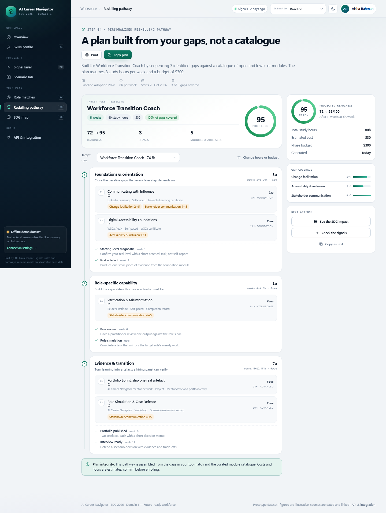

**SDG mapping — all 17 goals, scored with rationale and evidence**

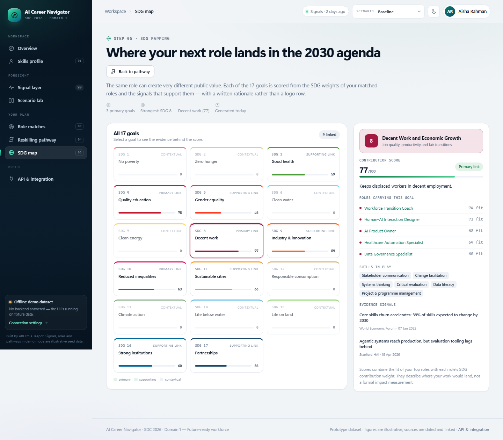

**Scenario lab — three futures, one profile**

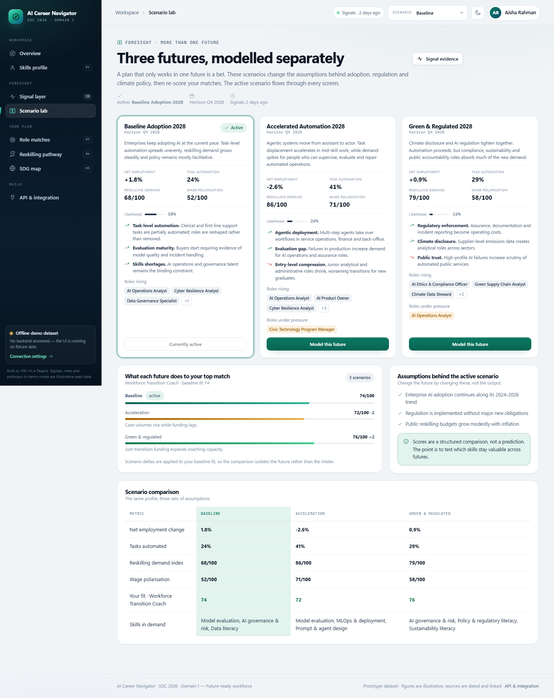

**Integration screen — live API status, endpoint contract and backend recipe**

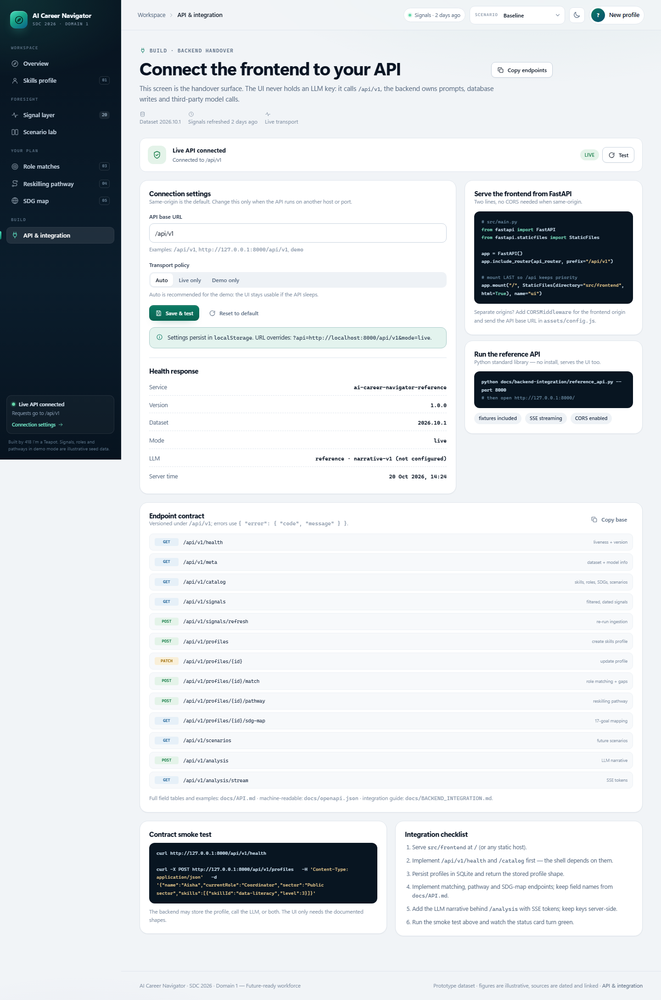

**Streamed LLM briefing — grounded in the profile, scenario and pathway**

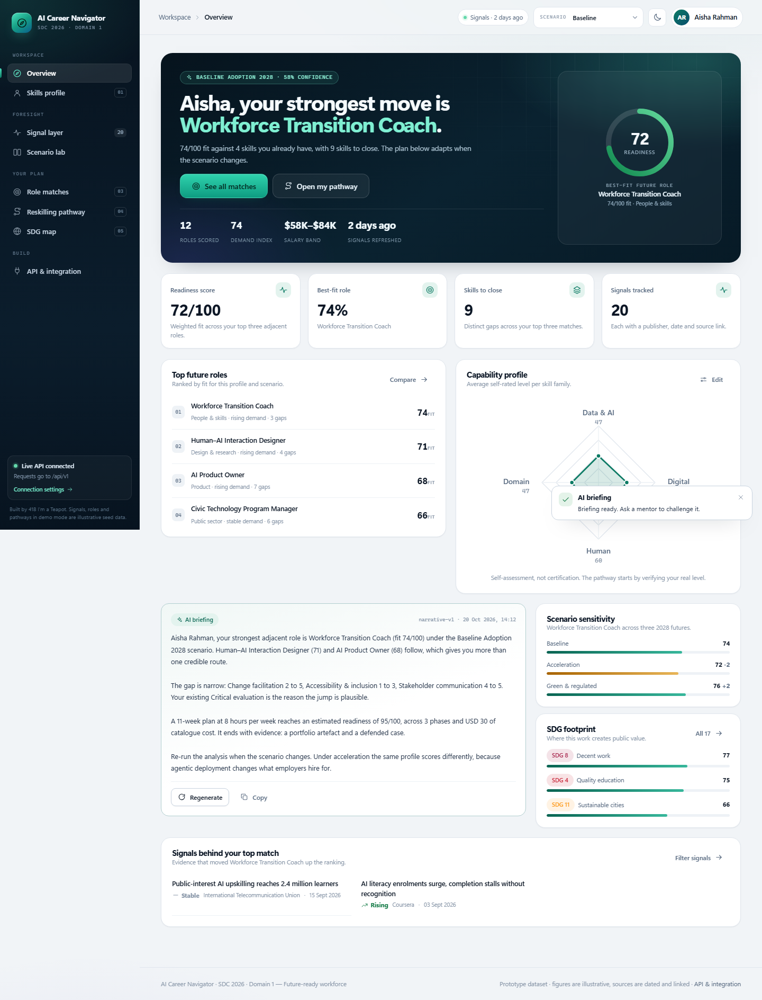

**Dark mode and mobile**

| Dark dashboard | Mobile dashboard |
| -------------- | ---------------- |
| 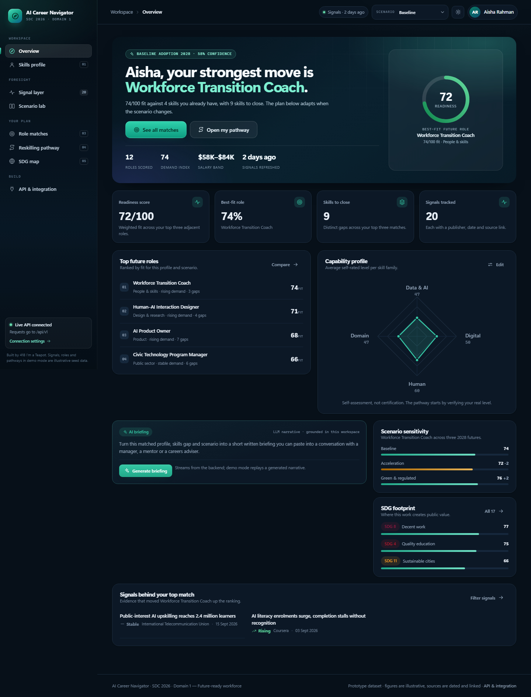 | 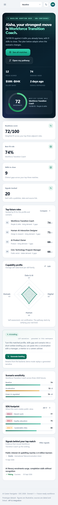 |

## Architecture

~~~text
┌──────────────────────────────┐         ┌────────────────────────────────────┐
│ Browser                      │  JSON   │ Backend (FastAPI, planned)          │
│  src/frontend                │ ──────► │  /api/v1/*                          │
│  ES modules, no build step   │         │   ├─ skills & profile service       │
│  fetch + EventSource         │  SSE    │   ├─ signal ingestion & scoring     │
│  localStorage: profile id    │ ◄────── │   ├─ matcher / pathway / SDG map    │
└──────────────────────────────┘         │   └─ LLM client (RunPod)            │
                                         │             │                       │
                                         │      SQLite (profiles, signals,     │
                                         │      analysis runs)                 │
                                         └─────────────┬───────────────────────┘
                                                       │ HTTPS
                                              ┌────────▼─────────┐
                                              │ RunPod serverless │
                                              │ GPU / LLM endpoint│
                                              └──────────────────┘
~~~

The frontend never calls the model directly. The backend owns prompts, keys and persistence;
the browser only sends ids and receives text or structured JSON.

## Tech stack

| Layer | Technology | Why |
| ----- | ---------- | --- |
| Frontend | Native ES modules, modern CSS, inline SVG | No build step, instant deploys, nothing to break on Replit |
| Backend | Python 3 + FastAPI (planned); reference implementation in the standard library | Simple deployment, typed routes |
| Database | SQLite | Independent local database, zero setup, portable |
| AI / compute | Third-party LLM via a RunPod serverless endpoint | GPU inference without hosting a model |
| Hosting / dev | Replit | One URL for UI + API |

## Repository structure

~~~text
.
├── docs/
│   ├── API.md                       # the frontend↔backend contract
│   ├── openapi.json                 # machine-readable OpenAPI 3.1 spec
│   ├── BACKEND_INTEGRATION.md       # step-by-step handover guide
│   ├── backend-integration/
│   │   ├── reference_api.py         # working implementation of the whole contract
│   │   ├── smoke_test.py            # 53-check contract test
│   │   ├── export_fixtures.py       # captures example responses
│   │   └── fixtures/                # captured example responses
│   └── screenshots/                 # UI evidence
├── src/
│   ├── frontend/                    # the application UI (serve this directory)
│   ├── main.py                      # backend entry point (teammate)
│   └── utils.py
├── tools/
│   ├── serve_frontend.py            # static server for frontend development
│   └── screenshot.mjs               # headless screenshots (no npm)
├── tests/
│   ├── test_frontend_assets.py      # assets, fixtures, module graph, contract checks
│   └── test_utils.py
├── requirements.txt
├── .env.example
└── README.md
~~~

## How to run

### 1. Fastest full-stack demo (reference API, no install)

~~~bash
python docs/backend-integration/reference_api.py --port 8000
# open http://127.0.0.1:8000/
~~~

This serves the real UI, implements every endpoint in `docs/API.md`, stores profiles in
`data/reference.db` (SQLite) and streams the narrative over SSE. The sidebar should read
**Live API connected**. The reference API is a contract reference for the backend owner, not
the production service.

### 2. Frontend only (offline demo dataset)

~~~bash
python tools/serve_frontend.py --port 8000
# open http://127.0.0.1:8000/
~~~

No API needed: the UI detects the missing backend and runs on dated fixtures, with a visible
**Offline demo dataset** badge. Add `#/overview?sample=1` to seed a sample profile.

### 3. With the production backend

The FastAPI service is being implemented by the backend owner; `src/main.py` is still the
project template. Once it serves the contract and mounts `src/frontend`, run:

~~~bash
pip install -r requirements.txt
python src/main.py
~~~

Until then, use the reference API in step 1 — it implements the same contract, including SSE
and the SQLite store. Integration steps: [docs/BACKEND_INTEGRATION.md](docs/BACKEND_INTEGRATION.md).

### Tests

~~~bash
python -m unittest discover tests
python docs/backend-integration/smoke_test.py --base http://127.0.0.1:8000/api/v1
~~~

## API contract

* Human-readable: [docs/API.md](docs/API.md)
* Machine-readable: [docs/openapi.json](docs/openapi.json)
* Integration guide: [docs/BACKEND_INTEGRATION.md](docs/BACKEND_INTEGRATION.md)
* Frontend notes: [src/frontend/README.md](src/frontend/README.md)

The contract covers health and metadata, the catalogue, the signal layer, profile intake,
matching, pathway generation, SDG mapping, scenarios, and the streamed LLM narrative. The
frontend's transport is switchable at runtime (`auto` / `live` / `demo`) and visible in the UI.

## Two-minute demo script

1. **Landing** — state the problem and the six must-haves. Click *Explore with a sample profile*.
2. **Overview** — readiness 72/100, top three roles, capability radar, SDG footprint.
3. **Intake** — show honest self-rating and the time/budget constraints that drive the plan.
4. **Signals** — open one signal's evidence: publisher, date, source link, affected roles.
5. **Matches** — compare two roles, open the gap matrix, then change the scenario in the top bar:
   the same profile re-ranks.
6. **Pathway** — phases, costs, milestones, coverage; generate or regenerate the AI briefing.
7. **SDG map** — pick a goal and show the role, skills and evidence behind its score.
8. **Connect** — show live/demo status and the endpoint contract. This is the backend handover.

## Data and provenance

The bundled dataset (`src/frontend/mock/*.json`) is **illustrative**: 23 skills, 12 future
roles, 3 scenarios, 20 dated signals and 37 learning modules. Publishers and dates are realistic
so the evidence layer can be demonstrated, but the figures are modelled, not official
statistics. The UI labels the dataset as a prototype, and the backend can replace the JSON with
real ingestion output without changing the frontend.

## How we use Replit *(required)*

* **Development:** the repository is imported into a Repl and run with `python src/main.py`,
  which serves both the API and the frontend.
* **Hosting:** the app is deployed with Replit Deployments; the live demo link above points at it.
* **Secrets:** `RUNPOD_API_KEY` and `RUNPOD_ENDPOINT_ID` live in Replit Secrets, never in the repo.

Proof of use: [`submission/REPLIT PROOF OF USE.pdf`](submission/REPLIT%20PROOF%20OF%20USE.pdf)

## How we use RunPod *(required)*

The narrative briefing is generated by an LLM served from a RunPod serverless endpoint. The
backend builds the prompt from the matched profile, scenario, pathway and the two most relevant
signals, calls RunPod, and streams the result to the browser as Server-Sent Events.

~~~bash
curl -X POST https://api.runpod.ai/v2/$RUNPOD_ENDPOINT_ID/runsync \
  -H "Authorization: Bearer $RUNPOD_API_KEY" \
  -H "Content-Type: application/json" \
  -d '{"input": {"prompt": "Write a 250-word careers briefing based on this profile…"}}'
~~~

Keys stay on the server; the frontend only sees `event: token` frames.

Proof of use: [`submission/RUNPOD PROOF OF USE.pdf`](submission/RUNPOD%20PROOF%20OF%20USE.pdf)

## Challenges and learnings

* **Showing evidence, not just answers.** Every score had to be explainable, so the matcher is a
  weighted overlap with published weights rather than an opaque model. The UI shows the gaps,
  the reasons and the scenario delta.
* **Making a demo survivable.** Backends fail during demos. The frontend ships a complete demo
  transport, probes `/health` with a three-second timeout, and always displays which mode is
  active.
* **Keeping the contract honest.** The API contract, OpenAPI spec, reference implementation,
  fixtures and a 53-check smoke test are all in the repo, so "the frontend expects this shape"
  is testable rather than a claim.
* **Ten packages of scope.** Six must-haves means six screens; the design system (tokens,
  components, charts) made it possible to keep them coherent.

## Future improvements

- [ ] Replace self-rated skills with verified evidence (assessments, work samples).
- [ ] Real ingestion pipeline with scheduled jobs and source monitoring.
- [ ] Employer-side view: post a role, see supply and gap forecasts.
- [ ] Localisation for Malay, Mandarin and Tamil.
- [ ] Persist and compare multiple profiles for programme planners.
- [ ] Add authentication and per-user workspaces.

## Team

| Name | Role | GitHub |
| ---- | ---- | ------ |
| CHEN XIANGYU | Team lead / backend | *(to be updated)* |
| *(teammate)* | Frontend / design system | *(to be updated)* |
| *(teammate)* | AI / RunPod integration | *(to be updated)* |
| *(teammate)* | Data & signals | *(to be updated)* |
| *(teammate)* | Research & presentation | *(to be updated)* |

## Submission checklist

- [x] Domain 1 and SDG track filled in
- [x] All six must-haves implemented and demonstrated
- [x] Working frontend with a live/demo transport switch
- [x] API contract + OpenAPI + integration guide
- [x] Reference API and contract smoke test
- [x] Automated tests for assets, fixtures and contract
- [ ] Slide deck link added
- [ ] Demo video link added
- [ ] Replit deployment URL added
- [ ] RunPod endpoint URL added
- [ ] "How to Run" verified on a clean clone
- [x] No API keys or secrets committed

## License

This project is licensed under the [Apache License 2.0](LICENSE).
